# 记事本 NotePad —— 移动软件开发期中实验

基于课程提供的 NotePad 示例（ContentProvider + SQLite）重写并扩展的记事本应用。
本项目**完成了全部两项基本要求**，并在其基础上实现了**六项扩展功能**（实验要求至少两项）。

> - 基本功能：列表时间戳、标题/内容搜索 —— **2 / 2 完成**
> - 扩展功能：自定义标签、置顶排序、UI 美化、深色主题与偏好设置、回收站、备份恢复 —— **6 项完成**
> - 运行截图：`docs/screenshots/` 下共 19 张，本文按「基础功能 / 扩展功能」分区展示

| 项目 | 内容 |
| --- | --- |
| 开发语言 | Java |
| 构建环境 | Android Gradle Plugin 9.3.2 / Gradle 9.5 / JDK 21 |
| 编译版本 | compileSdk 37，minSdk 24，targetSdk 37 |
| 依赖 | AppCompat 1.7、Material Components 1.12、RecyclerView 1.4 |
| 测试环境 | Android 17（API 37）Pixel 8 模拟器 |
| 安装包 | `docs/NotePad-debug.apk` |
| 实验报告 | `docs/实验报告.docx`、`docs/实验报告.md` |

---

## 目录

- [一、实验要求对照](#一实验要求对照)
- [二、基础功能（必做，含截图）](#二基础功能必做含截图)
- [三、扩展功能（完成 6 项，含截图）](#三扩展功能完成-6-项含截图)
- [四、原版 NotePad 源码分析与改造](#四原版-notepad-源码分析与改造)
- [五、运行方法](#五运行方法)
- [六、项目结构](#六项目结构)
- [七、数据库设计](#七数据库设计)
- [八、关键技术点](#八关键技术点)
- [九、测试记录](#九测试记录)
- [十、说明与限制](#十说明与限制)
- [十一、参考资料](#十一参考资料)

---

## 一、实验要求对照

### 1.1 基本要求（每个人必须完成）

| # | 要求 | 完成情况 | 主要实现位置 | 截图 |
| --- | --- | --- | --- | --- |
| 1 | NoteList 界面中笔记条目增加时间戳显示 | ✅ 已完成 | `NoteAdapter#bind`、`util/TimeUtils#formatListTime` | [01 列表时间戳](docs/screenshots/01-list.png) |
| 2 | 添加笔记查询功能（根据标题或内容查询） | ✅ 已完成 | `NoteListActivity` 搜索框、`data/NoteRepository#query`、`util/SearchText` | [02 标题搜索](docs/screenshots/02-search-title.png)、[03 正文搜索](docs/screenshots/03-search-content.png) |

时间戳按「今天 09:30 / 昨天 18:05 / 3月5日 / 2025年3月5日」显示，列表默认按修改时间倒序
（置顶笔记始终在最前）；编辑器底部还会显示完整的创建时间与修改时间。

### 1.2 附加功能（要求至少两项，实际完成六项）

| # | 扩展功能 | 对应实验建议 | 说明 | 截图 |
| --- | --- | --- | --- | --- |
| 1 | 自定义标签 | 笔记分类 | 默认提供 5 个标签，可新增、重命名、删除；每条笔记选一个标签，列表按标签筛选 | [04](docs/screenshots/04-category.png)、[19](docs/screenshots/19-tags.png) |
| 2 | 置顶与排序 | 界面与交互扩展 | 长按笔记可置顶；支持按修改时间、创建时间、标题排序（标题按中文拼音顺序） | [08](docs/screenshots/08-item-actions.png)、[15](docs/screenshots/15-sort.png) |
| 3 | UI 美化 | UI 美化（主题、背景、编辑器） | Material 3「纸墨」配色、卡片式列表、空状态插画、自定义启动图标、编辑器标签与字数统计 | [05](docs/screenshots/05-editor.png)、[06](docs/screenshots/06-editor-menu.png) |
| 4 | 深色主题与偏好设置 | 记事本的偏好设置功能 | 跟随系统 / 浅色 / 深色；可设置默认排序、是否显示摘要、正文字号 | [12](docs/screenshots/12-settings.png)、[13](docs/screenshots/13-list-dark.png)、[14](docs/screenshots/14-settings-dark.png) |
| 5 | 回收站（软删除） | 功能扩展（删除/恢复） | 删除只是把 `deleted` 置 1，可在回收站恢复或彻底删除，删除后支持撤销 | [09](docs/screenshots/09-delete-confirm.png)、[10](docs/screenshots/10-undo.png)、[11](docs/screenshots/11-trash.png) |
| 6 | 导出、备份与恢复 | 导出笔记，笔记的备份和恢复 | 单条笔记分享；全部笔记导出为 JSON 备份，并可从备份文件恢复 | [16](docs/screenshots/16-backup.png) |

> 结论：基本要求 2 项全部完成；附加功能完成 6 项，超过「至少两项」的要求。

### 1.3 工程与文档

| 项目 | 位置 / 说明 |
| --- | --- |
| 可运行安装包 | `docs/NotePad-debug.apk`（debug 签名，可直接安装） |
| 实验报告 | `docs/实验报告.docx`（Word 版）、`docs/实验报告.md`（Markdown 版） |
| 运行截图 | `docs/screenshots/`，共 19 张，覆盖基础功能与全部扩展功能 |
| 演示数据 | `tools/seed_demo_db.py`，可生成 6 条示例笔记与 6 个标签用于截图演示 |

---

## 二、基础功能（必做，含截图）

### 2.1 列表条目时间戳显示

实现位置：`NoteAdapter#bind`（绑定 `text_time`）与 `TimeUtils#formatListTime`。

| 时间 | 显示示例 | 说明 |
| --- | --- | --- |
| 今天 | `今天 10:35` | 只显示时:分，最常用 |
| 昨天 | `昨天 09:30` | 用「昨天」代替日期，更易读 |
| 今年内 | `11月12日` | 省略年份 |
| 更早 | `2025年3月5日` | 完整日期 |

列表按「置顶优先 + 修改时间倒序」排列；进入编辑器后，底部还会显示
「创建于 2026-11-15 10:35 · 修改于 2026-11-15 10:35」的完整时间，两种粒度互补。

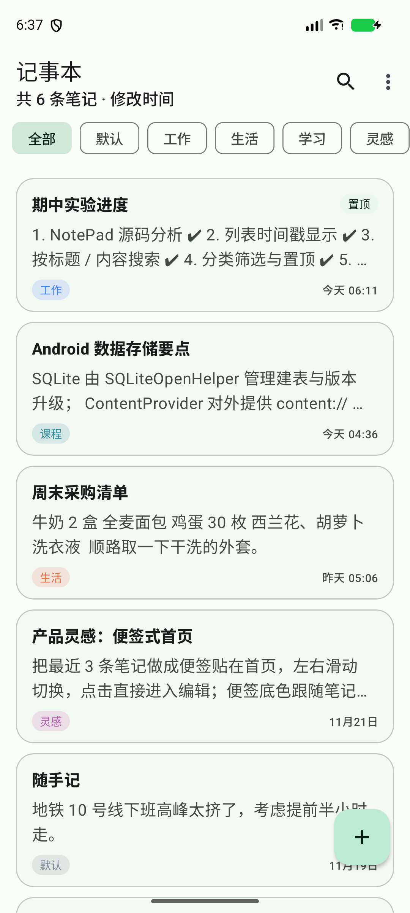

### 2.2 按标题或内容查询

实现位置：`NoteListActivity` 的 `SearchView` + `NoteRepository#query` + `SearchText`。

- 查询条件同时匹配 `title` 和 `note`：
  `title LIKE ? ESCAPE '\' OR note LIKE ? ESCAPE '\'`，用户输入中的 `%`、`_` 会被转义；
- 输入后做 280ms 防抖，避免每输入一个字就查一次数据库；
- 每次查询带递增序号，过期的异步结果会被丢弃，避免快速输入时列表错乱；
- 命中关键字在标题与正文摘要中加粗并染成主题色，摘要会把命中位置提到开头附近；
- 搜索框为空时恢复全部笔记；无结果时显示专门的空状态；
- 旋转屏幕后会保留搜索关键字与标签筛选（`onSaveInstanceState`）。

| 按标题搜索（标题高亮） | 按正文搜索（摘要高亮） |
| --- | --- |
| 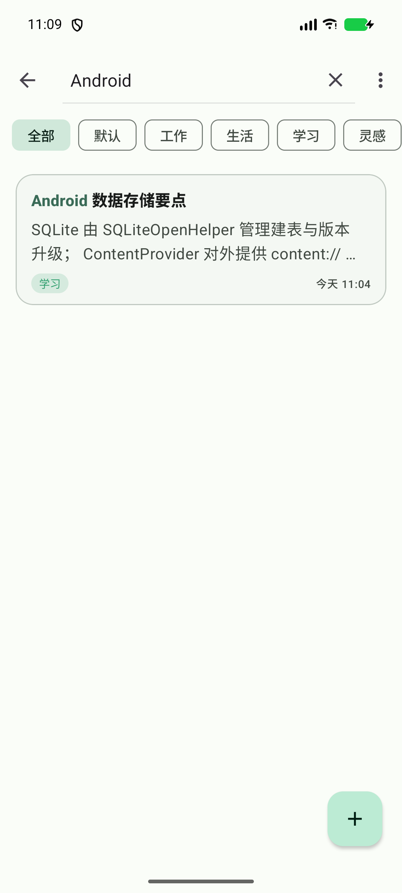 | 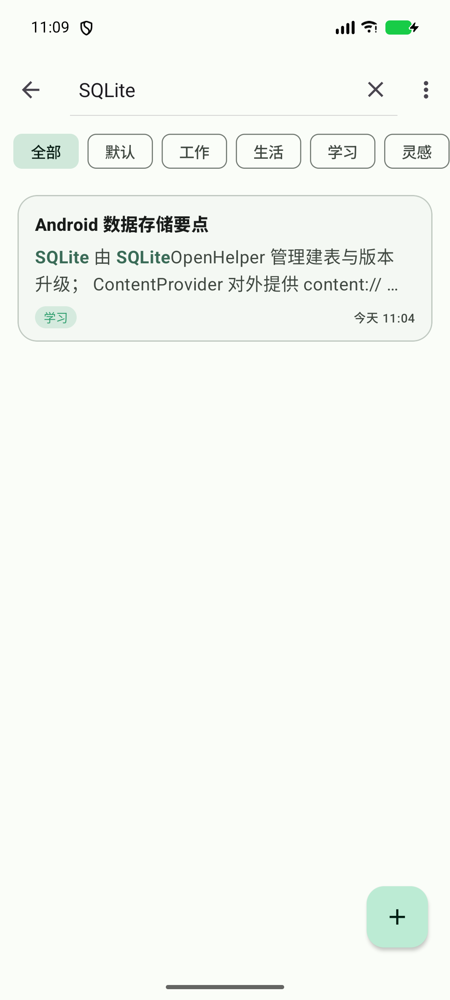 |

---

## 三、扩展功能（完成 6 项，含截图）

### 3.1 自定义标签

标签库由用户维护，默认预置 5 个标签，之后可在「标签管理」中随时调整：

- 首次启动预置「默认 / 工作 / 生活 / 学习 / 灵感」5 个标签；
- 进入「标签管理」可**新增**标签、**重命名**、**删除**，新建标签自动分配一种颜色；
- 每条笔记选择一个标签；重命名只改标签名称，已有笔记自动跟着更新；
- 删除正在使用的标签时，会提示受影响的笔记数量，并把它们迁移到「默认」标签，不会丢笔记；
- 列表顶部的筛选条和编辑器里的标签 Chip 都从数据库动态生成，标签再多也可以横向滚动。

| 标签管理（新增 / 重命名 / 删除） | 按标签筛选 |
| --- | --- |
| 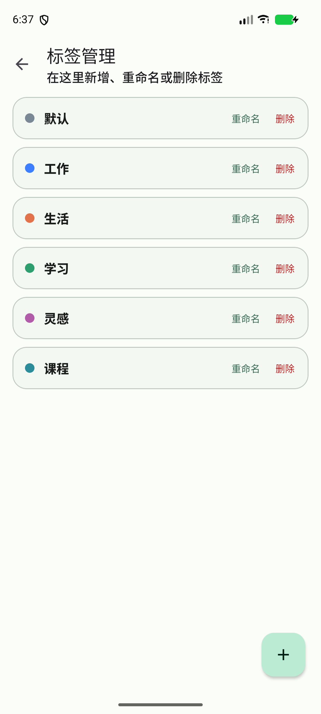 |  |

### 3.2 置顶与排序

- 长按列表条目可「置顶 / 取消置顶」，置顶笔记始终排在列表最前，并显示「置顶」标记；
- 排序支持修改时间、创建时间、标题三种方式，可在列表菜单或设置页切换；
- SQL 排序条件统一以 `pinned DESC` 开头；标题排序使用 `java.text.Collator`
  在内存中按中文拼音比较，而不是按 UTF-8 字节序。

| 长按条目操作（置顶 / 移入回收站 / 分享） | 排序方式选择 |
| --- | --- |
| 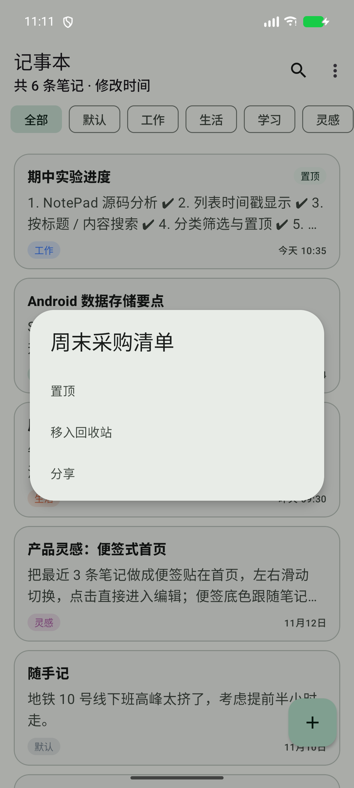 | 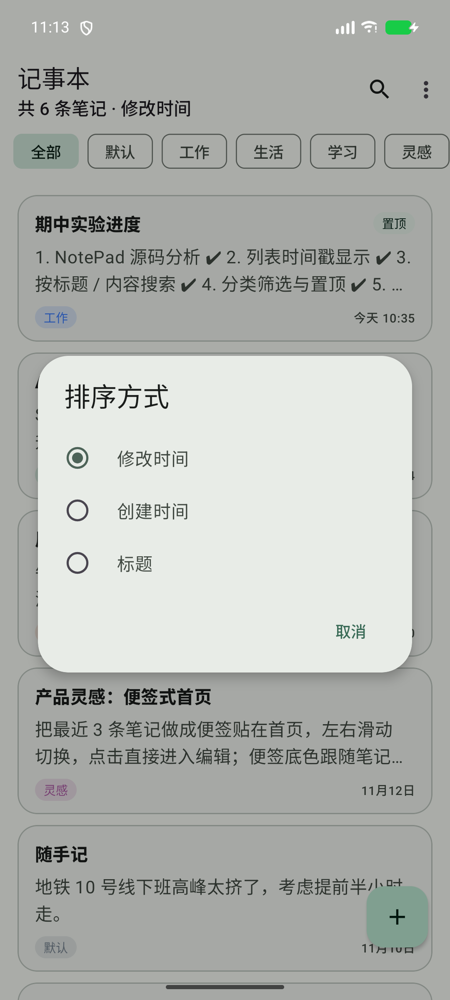 |

### 3.3 UI 美化与编辑器

- Material 3 组件与自定义「纸墨」配色：主色墨绿、背景暖白；
- 笔记以圆角卡片呈现，包含标题、两行摘要、标签、置顶标记与时间戳；
- 空状态有专门插画与文案，启动图标为自定义自适应图标；
- 编辑器提供标题、标签 Chip、正文、实时字数统计、完整时间信息，并支持自动保存；
- 编辑器菜单提供保存、置顶、标签管理、分享、删除；标题栏菜单提供排序、回收站、标签管理、备份恢复、设置、关于。

| 编辑器 | 编辑器菜单 |
| --- | --- |
| 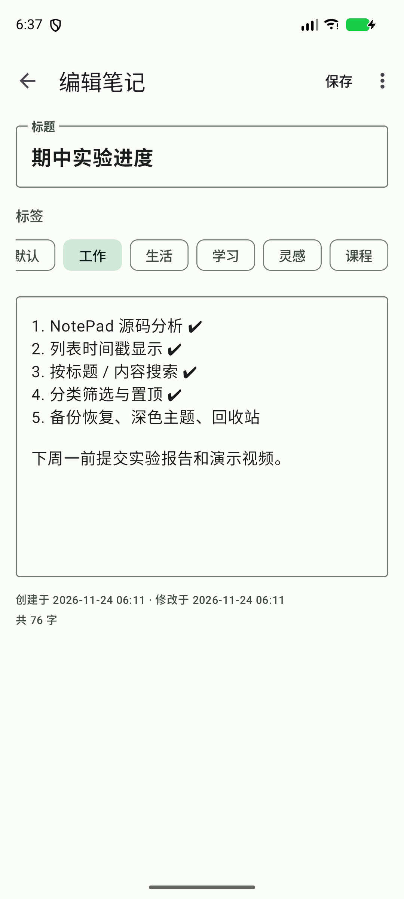 | 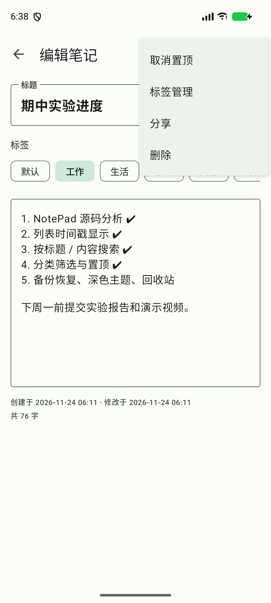 |

### 3.4 深色主题与偏好设置

- 主题：跟随系统 / 浅色 / 深色，通过 `values-night` 提供一整套深色配色；
- 默认排序方式：修改时间 / 创建时间 / 标题；
- 显示内容摘要：可关闭列表摘要，只保留标题与时间；
- 正文字号：14–26sp 可调，编辑器和列表预览同步生效。

| 偏好设置 | 深色主题列表 | 深色主题设置页 |
| --- | --- | --- |
| 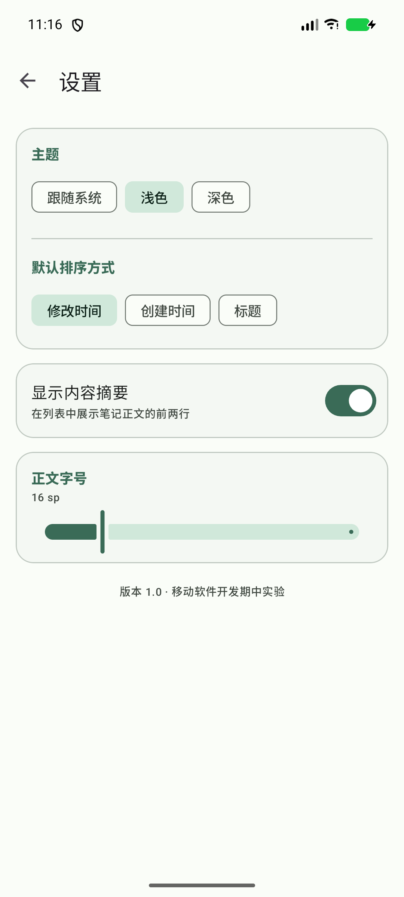 | 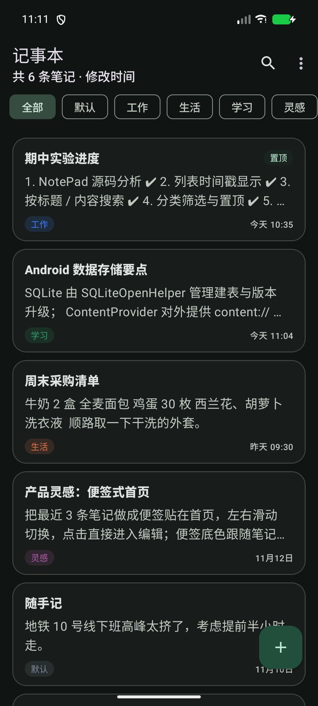 | 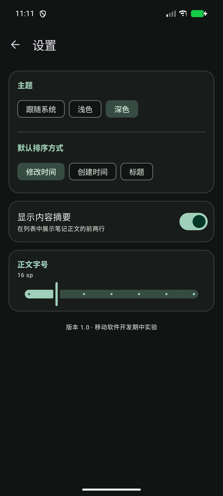 |

### 3.5 回收站（软删除）

删除采用软删除：只把 `deleted` 置 1 并记录 `deleted_at`，不真正删除数据。
列表左滑可直接移入回收站，并弹出带「撤销」的提示条；回收站中可恢复或彻底删除，
也支持一键清空。`deletePermanently` 才执行真正的 `DELETE`。

| 删除确认 | 删除后撤销 | 回收站 |
| --- | --- | --- |
| 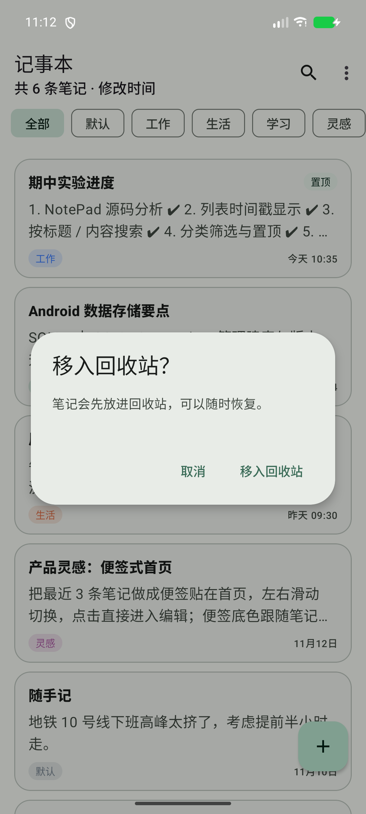 | 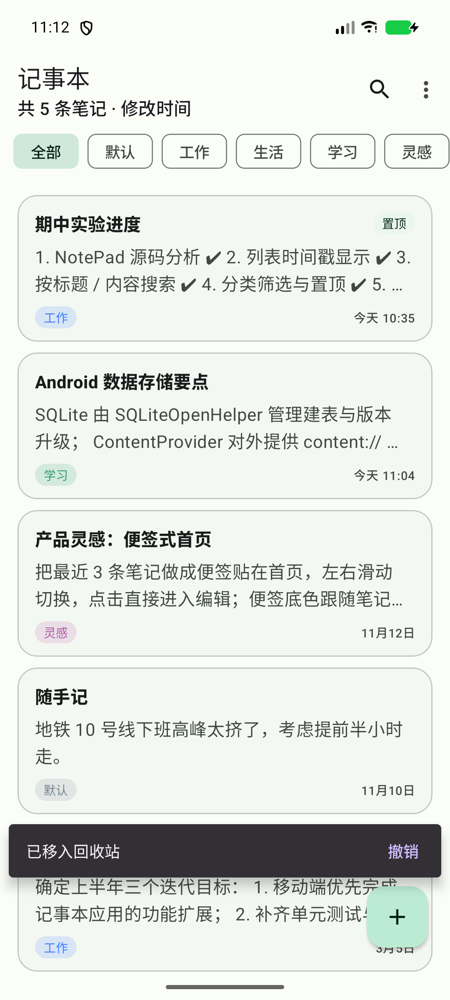 |  |

### 3.6 导出、备份与恢复

- 单条笔记可通过系统分享面板导出为纯文本；
- 「备份全部笔记」把标签、标题、正文、创建/修改时间、置顶、删除标记序列化为 JSON，
  通过系统文件选择器（SAF）保存，无需申请存储权限；
- 「从备份文件恢复」解析 JSON 后调用 `bulkInsert` 批量写入，Provider 内部使用事务保证原子性，
  并保留原始的创建时间、修改时间、标签与置顶状态。

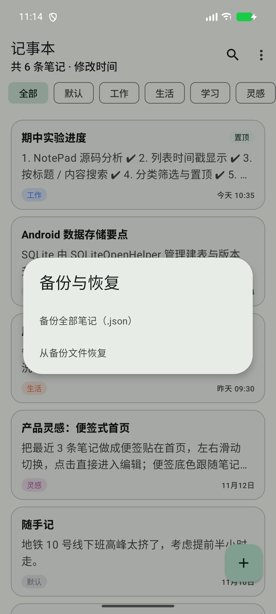

### 3.7 其他界面

| 列表菜单（排序 / 回收站 / 备份 / 设置 / 关于） | 关于 | 空状态 |
| --- | --- | --- |
| 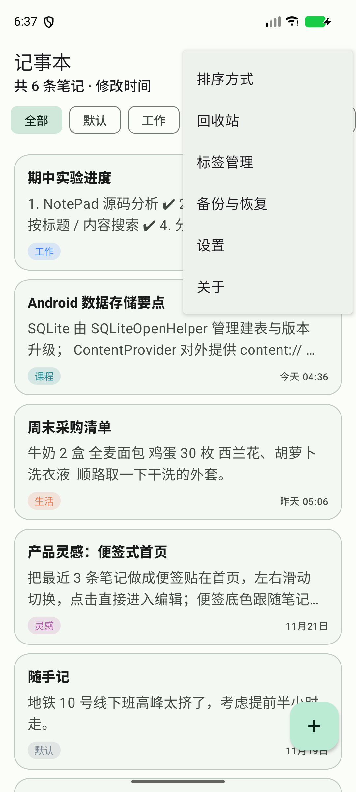 | 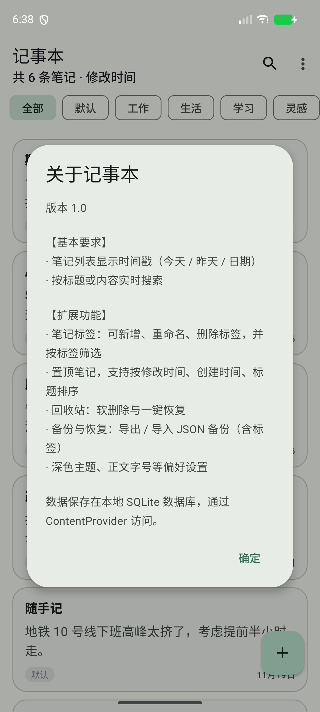 | 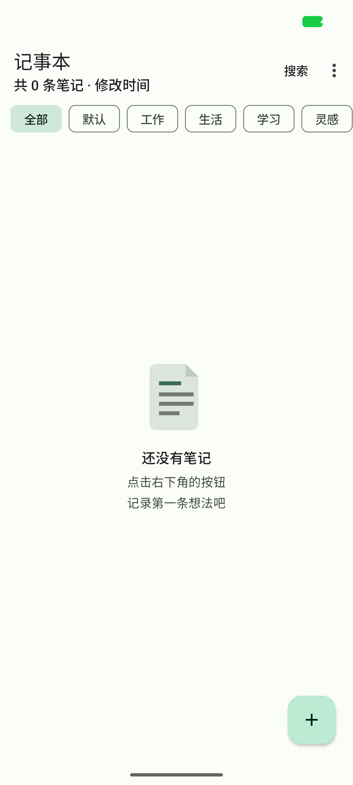 |

---

## 四、原版 NotePad 源码分析与改造

实验要求先阅读课程提供的 NotePad 源码，再在其基础上扩展。下面先分析原版结构，
再说明本项目做了哪些改造、为什么这样改。

### 4.1 原版 NotePad 的结构

| 文件 | 职责 | 关键实现 |
| --- | --- | --- |
| `NotePad.java` | 契约类 | 定义 `AUTHORITY`（`com.google.provider.NotePad`）、`content://` URI、MIME 类型、列名，`DEFAULT_SORT_ORDER = "modified DESC"` |
| `NotesList.java` | 笔记列表 | 继承 `ListActivity`，用 `managedQuery` 查询，`SimpleCursorAdapter` 只把 `title` 映射到 `android.R.id.text1`；长按弹出打开/复制/删除菜单，菜单提供新建与粘贴 |
| `NoteEditor.java` | 新建 / 编辑 | 处理 `ACTION_EDIT`、`ACTION_INSERT`、`ACTION_PASTE`；`LinedEditText` 绘制横线；`onPause` 自动保存；`updateNote` 更新时间戳；`cancelNote` 撤销 |
| `NotePadProvider.java` | 数据提供者 | `UriMatcher` 区分 `notes` 与 `notes/#`，`SQLiteOpenHelper` 建库（版本 2），`SQLiteQueryBuilder` 查询，CRUD 后 `notifyChange`，并支持 Live Folder 与文本流输出 |

### 4.2 原版存在的问题

结合实验要求与日常使用，原版主要有以下不足：

1. **列表信息太少**：只显示标题，没有时间戳、正文摘要、标签，无法快速判断笔记的新旧和内容；
2. **没有查询功能**：笔记变多后只能靠滚动查找；
3. **数据库操作在主线程**：原版注释也说明 `managedQuery` / `ContentResolver` 调用发生在 UI 线程，
   数据量大时会卡顿；
4. **升级即丢数据**：`onUpgrade` 直接 `DROP TABLE` 再重建，用户笔记会全部丢失；
5. **删除不可恢复**：删除直接执行 `DELETE`，误删无法找回；
6. **界面与交互陈旧**：`ListActivity` + `SimpleCursorAdapter` 的样式固定，缺少主题、排序、设置等现代记事本常见能力。

### 4.3 本项目的改造对照

| 原版 | 本项目 | 改造原因 |
| --- | --- | --- |
| `NotesList` + `ListView` + `SimpleCursorAdapter` | `NoteListActivity` + `RecyclerView` + `NoteAdapter` | 支持卡片布局、标题/摘要/标签/置顶/时间戳多字段绑定 |
| 无搜索 | `SearchView` + `NoteRepository#query` + 防抖/高亮 | 满足「按标题或内容查询」的基本要求 |
| 主线程数据库操作 | `Async.run` 后台线程 + 主线程回调 | 避免阻塞 UI；查询带序号丢弃过期结果 |
| `onUpgrade` 删表重建 | 逐列 `ALTER TABLE` + `PRAGMA table_info` 检查 | 升级保留用户数据 |
| 删除即 `DELETE` | `deleted / deleted_at` 软删除 + 回收站 | 误删可恢复，支持撤销与清空 |
| 无标签 / 置顶 | `tags` 表 + `notes.category` 存标签 key + 标签管理页 | 标签可由用户新增/重命名/删除，笔记通过 key 引用标签 |
| 无主题 / 设置 | `values-night` + `Prefs` + 设置页 | 深色主题、默认排序、摘要开关、字号 |
| 无备份 | `BackupUtils` + SAF + JSON | 导出与恢复，换机/重装前可备份 |
| 原版 `ContentProvider` 契约 | 保留 Provider + 新增 `NoteRepository` 仓库层 | 保留课程要求的数据共享机制，同时让界面不直接写 SQL |

### 4.4 保留的原版设计

- 继续使用 **ContentProvider + SQLite** 作为数据层，而不是换成 Room；
- 继续使用契约类集中管理 URI、MIME 与列名；
- 保留「离开编辑器自动保存」的交互习惯；
- 保留删除前的确认对话框，降低误操作。

---

## 五、运行方法

### Android Studio

1. `File → Open`，选择本目录 `NotePad`；
2. 等待 Gradle Sync 完成（首次会下载依赖）；
3. 选择设备或模拟器，点击 Run。

项目 `local.properties` 中的 `sdk.dir` 需要改为你本机的 Android SDK 路径。

### 命令行

```bash
# 生成 debug 安装包（Windows 可改用 gradlew.bat）
./gradlew :app:assembleDebug

# 安装到已连接的设备
adb install -r app/build/outputs/apk/debug/app-debug.apk
```

产物路径：`app/build/outputs/apk/debug/app-debug.apk`，仓库中也放置了一份
`docs/NotePad-debug.apk` 便于直接安装。

### 演示数据（可选）

`tools/seed_demo_db.py` 可生成一份包含 6 条示例笔记、6 个标签（含「课程」自定义标签）的数据库，
用于截图演示（需要 debug 包，通过 `run-as` 推送）：

```bash
python tools/seed_demo_db.py docs/note_pad.db
adb push docs/note_pad.db /data/local/tmp/note_pad.db
adb shell run-as com.example.android.notepad cp /data/local/tmp/note_pad.db databases/note_pad.db
```

正常使用时不需要这一步，应用首次启动会自动建库。

---

## 六、项目结构

```
NotePad/
├── app/src/main/
│   ├── java/com/example/android/notepad/
│   │   ├── App.java                     # Application：应用主题（夜间模式）
│   │   ├── NotePad.java                 # 契约类：AUTHORITY、URI、列名、MIME
│   │   ├── NotePadProvider.java         # ContentProvider：建表、升级、增删改查、批量插入
│   │   ├── data/
│   │   │   ├── Note.java                # 笔记实体（Cursor → 对象）
│   │   │   ├── NoteCategory.java        # 默认标签定义（兼容旧分类 key）
│   │   │   ├── Tag.java                 # 标签实体（key / 名称 / 颜色）
│   │   │   ├── TagPalette.java          # 自定义标签调色板
│   │   │   ├── NoteRepository.java      # 数据仓库：查询条件、排序、标签、软删除
│   │   │   └── SortOrder.java           # 排序方式枚举
│   │   ├── ui/
│   │   │   ├── BaseActivity.java        # 边到边、Toolbar、系统栏图标
│   │   │   ├── NoteListActivity.java    # 列表：搜索、标签筛选、排序、备份恢复
│   │   │   ├── NoteAdapter.java         # 列表适配器：时间戳、标签、置顶、高亮
│   │   │   ├── NoteEditorActivity.java  # 编辑器：自动保存、标签、字数、置顶
│   │   │   ├── TagActivity.java         # 标签管理：新增 / 重命名 / 删除
│   │   │   ├── TagAdapter.java
│   │   │   ├── TrashActivity.java       # 回收站
│   │   │   ├── TrashAdapter.java
│   │   │   ├── SettingsActivity.java    # 偏好设置
│   │   │   ├── Chips.java               # 单选 Chip 工具
│   │   │   └── Pills.java               # 标签小标签着色
│   │   └── util/
│   │       ├── Async.java               # 后台线程 + 主线程回调
│   │       ├── BackupUtils.java         # JSON 备份的序列化 / 反序列化
│   │       ├── Prefs.java               # SharedPreferences 封装
│   │       ├── SearchText.java          # 关键字高亮与摘要截取
│   │       ├── TimeUtils.java           # 时间戳格式化
│   │       └── WindowInsetsHelper.java  # 系统栏 / 输入法内边距
│   └── res/
│       ├── layout/                      # 列表、编辑器、回收站、设置等界面
│       ├── values/                      # 字符串、颜色、主题、样式、尺寸
│       ├── values-night/                # 深色模式配色
│       ├── menu/  drawable/  mipmap-*/  # 菜单、图标、启动图标
│       └── xml/                         # 备份规则
├── docs/
│   ├── screenshots/                     # 19 张运行截图
│   ├── 实验报告.docx / .md              # 实验报告
│   └── NotePad-debug.apk                # 可直接安装的 debug 包
├── tools/
│   ├── seed_demo_db.py                  # 演示数据生成脚本
│   └── build_report_docx.py             # 由 Markdown 生成实验报告 Word 版
├── gradle/libs.versions.toml            # 依赖版本统一管理
└── build.gradle.kts / settings.gradle.kts
```

---

## 七、数据库设计

数据库：`note_pad.db`，包含 `notes` 与 `tags` 两张表（数据库版本 4）。

`notes` 表：

| 列 | 类型 | 说明 |
| --- | --- | --- |
| `_id` | INTEGER | 主键，自增 |
| `title` | TEXT | 标题 |
| `note` | TEXT | 正文 |
| `created` | INTEGER | 创建时间（毫秒时间戳） |
| `modified` | INTEGER | 修改时间（毫秒时间戳） |
| `category` | TEXT | 标签 key（列名沿用旧版本；内置 default/work/...，自定义 tag_...） |
| `pinned` | INTEGER | 是否置顶：0 / 1 |
| `deleted` | INTEGER | 是否在回收站：0 / 1 |
| `deleted_at` | INTEGER | 移入回收站的时间 |

`tags` 表：

| 列 | 类型 | 说明 |
| --- | --- | --- |
| `tag_key` | TEXT | 主键，稳定 key；笔记通过它引用标签 |
| `label` | TEXT | 用户可见名称，可重命名 |
| `color` | INTEGER | ARGB 颜色，新建时自动分配 |
| `created` | INTEGER | 创建时间，决定筛选条顺序 |

索引：`idx_notes_list (deleted, pinned, modified)`，覆盖列表页最常用的查询顺序。

ContentProvider 接口：

| URI | 说明 |
| --- | --- |
| `content://com.example.android.notepad/notes` | 笔记集合（可带 selection 实现搜索/标签筛选） |
| `content://com.example.android.notepad/notes/#` | 单条笔记 |
| `content://com.example.android.notepad/tags` | 标签集合（新增/重命名/删除） |

数据库升级策略：升级到 v4 时只新建 `tags` 表并写入默认标签，`notes` 表不重建；
原有 `category` 值（default/work/...）直接作为标签 key 继续使用，已有笔记不会丢失。

---

## 八、关键技术点

1. **时间戳**：`TimeUtils.formatListTime` 用 `Calendar` 判断今天 / 昨天 / 同年，分别输出
   `今天 09:30`、`昨天 18:05`、`3月5日`、`2025年3月5日`。
2. **搜索**：`NoteRepository.query` 用
   `title LIKE ? ESCAPE '\' OR note LIKE ? ESCAPE '\'` 同时匹配标题与正文，
   用户输入中的 `%`、`_` 会被转义；输入 280ms 防抖后才查询；命中关键字在标题和摘要中
   加粗并染成主题色（`SearchText.highlight`），摘要会把命中位置提到开头附近。
3. **标签**：`tags` 表保存稳定的 `tag_key`、显示名与颜色，`notes.category` 只存 key。
   重命名标签只改 `label`，已有笔记自动跟随；删除使用中的标签时，先把笔记迁到
   `default` 再删除标签，不会出现无标签笔记。标签背景使用 16% 透明度，深浅色主题下都清晰。
4. **软删除**：删除只是把 `deleted` 置 1 并记录 `deleted_at`，回收站可恢复；
   `deletePermanently` 才真正执行 `DELETE`。
5. **备份恢复**：`BackupUtils` 用 `org.json` 把标签与笔记序列化为 JSON（格式版本 2），
   通过 SAF（系统文件选择器）保存和读取，无需申请存储权限；旧版备份没有 tags 字段也能恢复。
6. **边到边适配**：`WindowCompat.setDecorFitsSystemWindows(false)` 后，
   `WindowInsetsHelper` 把状态栏、导航栏、输入法高度加到对应 View 的内边距上，
   适配 Android 15+ 的强制边到边显示。
7. **线程调度**：所有数据库读写通过 `Async.run` 在后台线程执行，结果回到主线程更新 UI；
   只有编辑器退出前的保存是同步写入（一条 SQLite 写操作仅几毫秒，保证数据一定落盘）。
8. **状态保持**：搜索关键字与标签筛选写入 `onSaveInstanceState`，旋转屏幕或进程重建后
   自动恢复搜索框展开状态、关键字与标签选中项。

---

## 九、测试记录

测试在 Android 17（API 37）Pixel 8 模拟器上完成：

| 编号 | 测试内容 | 操作步骤 | 预期结果 | 结果 |
| --- | --- | --- | --- | --- |
| 1 | 新建笔记 | 点击右下角按钮，输入标题与正文后返回 | 列表出现该笔记，时间戳为「今天 时:分」 | 通过 |
| 2 | 自动保存 | 编辑内容后直接按返回键 | 无需手动保存，内容已写入数据库 | 通过 |
| 3 | 时间戳显示 | 观察不同修改时间的笔记 | 分别显示今天、昨天、月日、年月日 | 通过 |
| 4 | 按标题搜索 | 搜索框输入标题中的关键字 | 只显示匹配笔记，标题关键字高亮 | 通过 |
| 5 | 按内容搜索 | 搜索框输入正文中的关键字 | 匹配正文，摘要中关键字高亮并提前 | 通过 |
| 6 | 标签筛选 | 点击「工作」标签 | 列表只显示该标签的笔记，标题栏显示筛选条数 | 通过 |
| 7 | 置顶 | 长按笔记选择置顶 | 笔记排到列表最前，显示「置顶」标记 | 通过 |
| 8 | 排序切换 | 菜单选择按创建时间、按标题 | 列表顺序相应变化，标题栏显示当前排序 | 通过 |
| 9 | 删除与撤销 | 左滑笔记，点击提示条上的撤销 | 笔记移入回收站，撤销后回到列表 | 通过 |
| 10 | 回收站 | 进入回收站，恢复或彻底删除 | 恢复后回到列表，彻底删除后不可找回 | 通过 |
| 11 | 主题切换 | 设置中切换深色 | 界面立即切换为深色配色 | 通过 |
| 12 | 字号与摘要 | 调整正文字号、关闭摘要显示 | 列表预览字号变化，摘要区域隐藏 | 通过 |
| 13 | 旋转保持筛选 | 输入关键字/选择标签后旋转屏幕 | 搜索框与标签选中项保持，结果不变 | 通过 |
| 14 | 新建标签 | 标签管理页点击「+」，输入名称保存 | 列表新增标签，颜色自动分配，筛选条同步出现 | 通过 |
| 15 | 重命名标签 | 点击标签的「重命名」，修改名称保存 | 标签显示新名称，已有笔记的标签同步更新 | 通过 |
| 16 | 删除使用中的标签 | 删除一个已有笔记使用的标签 | 提示受影响条数；确认后笔记归入「默认」，标签消失 | 通过 |
| 17 | 编辑器选择标签 | 打开笔记，在「标签」Chip 中选择新标签并返回 | 列表卡片显示新标签，数据库 category 已更新 | 通过 |

构建验证：`./gradlew :app:assembleDebug` 构建成功；`./gradlew :app:lintDebug` 无 error
（剩余提示为依赖版本、全量刷新等不影响功能与评分的已知项）。

---

## 十、说明与限制

- 备份/恢复使用系统文件选择器（SAF）。在没有文件管理服务、未登录账号或离线导致
  `DocumentsUI` 无法工作的环境中，选择器可能无法打开；真机上正常工作。
- 应用数据全部保存在本地 SQLite，卸载应用会同时删除数据，可先用「备份全部笔记」导出。
- 演示截图来自 Android 17（API 37）模拟器，因此状态栏时间与主机时区可能不同。
- 当前每条笔记只支持一个标签（单品标签）；如需多标签，可在 `tags` 表旁增加 `note_tags` 关联表扩展。
- 本项目聚焦课程要求的「时间戳 + 搜索」与常见记事本扩展，未实现图片、语音、OCR 等多类型笔记。

---

## 十一、参考资料

- 原版 NotePad 示例源码：<https://github.com/fjnu-cse/NotePad>
- NotePad 源码分析：<https://blog.csdn.net/llfjfz/article/details/67638499>
- SQLite 数据存储：<https://developer.android.google.cn/training/data-storage/sqlite>
- ContentProvider 基础：<https://developer.android.google.cn/guide/topics/providers/content-provider-basics>
- Material 3 设计规范：<https://m3.material.io/>
