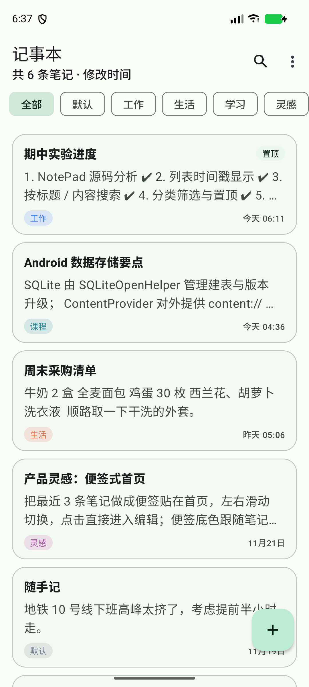
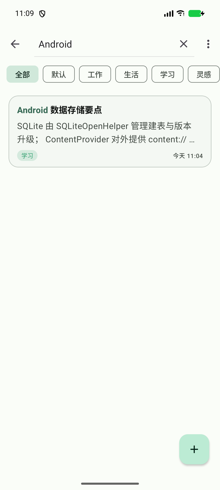
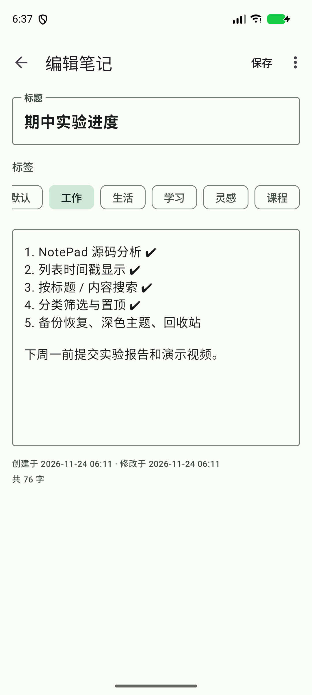
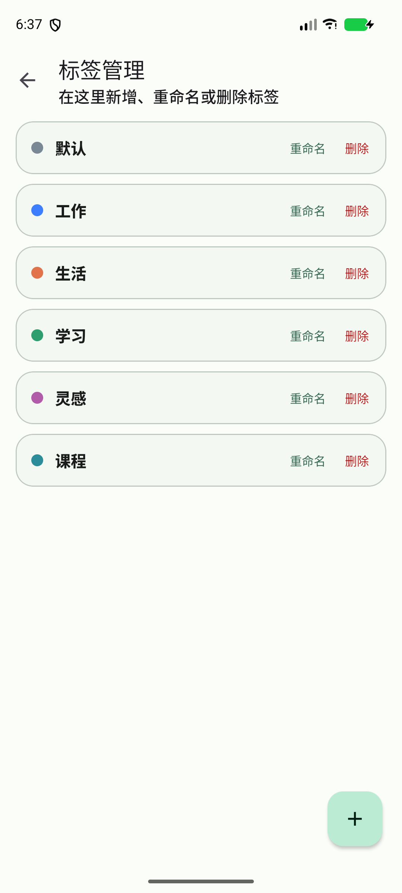
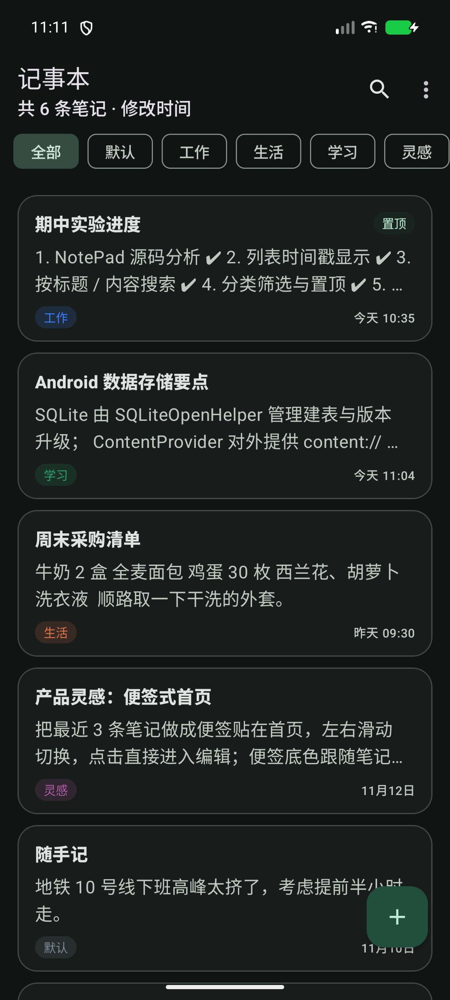
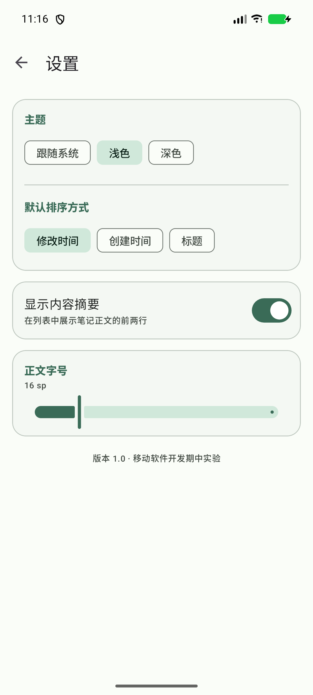

# 移动软件开发期中实验报告

## 实验名称
NotePad 记事本应用的功能扩展

| 姓名 | 学号 | 班级 | 日期 |
| --- | --- | --- | --- |
|  |  |  | 2026 年 11 月 |

## 一、实验目的

1. 熟悉 Android 应用的基本组成：Activity、RecyclerView、Material 主题与资源体系。
2. 掌握使用 SQLite 与 ContentProvider 进行本地数据持久化的方法。
3. 在理解 NotePad 示例源码的基础上，完成列表时间戳显示、笔记搜索两项基本功能。
4. 结合日常记事本的使用习惯扩展功能，掌握软删除、偏好设置、文件备份等常见设计。

## 二、实验环境

| 项目 | 内容 |
| --- | --- |
| 操作系统 | Windows 11 |
| 开发工具 | Android Studio（AI-261 版本） |
| JDK | OpenJDK 21 |
| 构建工具 | Gradle 9.5 + Android Gradle Plugin 9.3.2 |
| 编译 / 目标版本 | compileSdk 37，targetSdk 37，minSdk 24 |
| 运行环境 | Android 17（API 37）x86_64 模拟器 |
| 开发语言 | Java |

## 三、实验内容

### 3.1 基本要求

1. 在 NoteList 界面的笔记条目中增加时间戳显示。
2. 增加笔记查询功能，支持按标题或内容查询。

### 3.2 扩展功能

在基本要求之外实现了六项扩展功能：自定义标签（新增 / 重命名 / 删除）、置顶与多种排序、
UI 美化与深色主题、偏好设置、回收站（软删除与恢复）、笔记备份与恢复。

### 3.3 原版 NotePad 源码分析

原版示例由四个核心文件组成：

1. `NotePad.java`：契约类，约定 `AUTHORITY`、`content://` URI、MIME 类型与列名，
   默认排序为 `modified DESC`。
2. `NotesList.java`：继承 `ListActivity`，用 `managedQuery` 查询，
   `SimpleCursorAdapter` 只把标题映射到列表项；长按提供打开、复制、删除，
   菜单提供新建与粘贴。
3. `NoteEditor.java`：处理 `ACTION_EDIT / ACTION_INSERT / ACTION_PASTE`；
   自定义 `LinedEditText` 绘制横线；在 `onPause` 中自动保存；`updateNote`
   更新修改时间，`cancelNote` 撤销修改。
4. `NotePadProvider.java`：用 `UriMatcher` 区分集合与单条记录，
   `SQLiteOpenHelper` 建库（版本 2），`SQLiteQueryBuilder` 查询，
   增删改查后调用 `notifyChange`，并支持 Live Folder 与文本流输出。

原版的主要不足是：列表只有标题、没有查询；数据库操作在主线程执行；
数据库升级直接删表重建；删除不可恢复；界面与交互较陈旧。

本项目在保留 ContentProvider + SQLite 的前提下做了对应改造：

| 原版 | 本项目 | 改造原因 |
| --- | --- | --- |
| `ListActivity` + `SimpleCursorAdapter` | `RecyclerView` + `NoteAdapter` | 同时展示标题、摘要、标签、置顶与时间戳 |
| 无搜索 | `SearchView` + `NoteRepository` + 防抖与高亮 | 完成按标题/内容查询的基本要求 |
| 主线程数据库操作 | `Async` 后台线程 + 主线程回调 | 避免阻塞界面，过期结果按序号丢弃 |
| `onUpgrade` 删表重建 | 逐列 `ALTER TABLE` 检查后添加 | 升级时保留用户已有笔记 |
| 删除即 `DELETE` | `deleted / deleted_at` 软删除 + 回收站 | 误删可恢复，支持撤销 |
| 无分类、置顶 | `tags` 表 + `notes.category` 存标签 key + 标签管理页 | 标签可新增/重命名/删除，笔记通过 key 引用标签 |
| 无主题、设置、备份 | `values-night`、`Prefs`、`BackupUtils` | 深色主题、偏好设置、JSON 备份恢复 |

## 四、系统设计

### 4.1 总体结构

应用沿用 NotePad 示例「ContentProvider + SQLite」的数据层，并在其上补充了
数据仓库层和界面层，形成四层结构：

1. 数据层：`NotePadProvider` 负责建表、升级与增删改查，`NotePad` 契约类约定 URI 与列名。
2. 仓库层：`NoteRepository` 把查询条件（搜索、标签、排序）封装成方法，界面不直接写 SQL 条件。
3. 界面层：列表页、编辑页、回收站、标签管理、设置页五个 Activity，配合三个 RecyclerView 适配器。
4. 工具层：时间格式化、搜索高亮、偏好设置、备份序列化、线程调度、窗口内边距。

### 4.2 数据库设计

表 `notes` 在原示例的 `title、note、created、modified` 四个字段基础上，
增加了 `category、pinned、deleted、deleted_at` 四个字段：

| 列名 | 类型 | 说明 |
| --- | --- | --- |
| _id | INTEGER | 主键，自增 |
| title | TEXT | 标题 |
| note | TEXT | 正文 |
| created | INTEGER | 创建时间（毫秒时间戳） |
| modified | INTEGER | 修改时间（毫秒时间戳） |
| category | TEXT | 标签 key（内置 default/work/...，自定义 tag_...） |
| pinned | INTEGER | 是否置顶 |
| deleted | INTEGER | 是否在回收站 |
| deleted_at | INTEGER | 移入回收站的时间 |

新增 `tags` 表保存用户标签：

| 列名 | 类型 | 说明 |
| --- | --- | --- |
| tag_key | TEXT | 主键，稳定 key，笔记通过它引用标签 |
| label | TEXT | 用户可见名称，可重命名 |
| color | INTEGER | ARGB 颜色 |
| created | INTEGER | 创建时间，决定筛选条顺序 |

数据库版本为 4。升级到 v4 时只新建 `tags` 表并写入默认标签，
`notes` 表不重建；原有 `category` 值直接作为标签 key 继续使用，已有笔记不会丢失。
同时为列表页建立了 `(deleted, pinned, modified)` 联合索引。

### 4.3 界面流程

应用启动进入笔记列表：顶部是标题栏（显示笔记数量与当前排序方式）、搜索入口与标签筛选条，
主体是笔记卡片列表，右下角是新建按钮。点击卡片进入编辑器，长按卡片弹出置顶、删除、分享菜单，
向左滑动可直接移入回收站并支持撤销。标题栏菜单提供排序、回收站、标签管理、备份恢复、设置与关于。

## 五、关键功能实现

### 5.1 列表时间戳

时间戳根据与当前时间的距离选择不同格式，比直接显示完整日期更符合阅读习惯：

```java
public static String formatListTime(long millis) {
    Calendar now = Calendar.getInstance();
    Calendar target = Calendar.getInstance();
    target.setTimeInMillis(millis);
    if (isSameDay(now, target)) {
        return "今天 " + format(millis, "HH:mm");
    }
    Calendar yesterday = Calendar.getInstance();
    yesterday.add(Calendar.DAY_OF_YEAR, -1);
    if (isSameDay(yesterday, target)) {
        return "昨天 " + format(millis, "HH:mm");
    }
    if (now.get(Calendar.YEAR) == target.get(Calendar.YEAR)) {
        return format(millis, "M月d日");
    }
    return format(millis, "yyyy年M月d日");
}
```

列表条目右侧显示上述时间，编辑器底部再显示完整的「创建于 … · 修改于 …」，两种粒度互相补充。

### 5.2 搜索功能

搜索在仓库层拼装 SQL 条件，同时匹配标题与正文，并转义用户输入中的通配符：

```java
String like = "%" + escapeLike(trimmedKeyword) + "%";
selection.append(" AND (")
        .append(NotePad.Notes.COLUMN_NAME_TITLE).append(" LIKE ? ESCAPE '\\'")
        .append(" OR ")
        .append(NotePad.Notes.COLUMN_NAME_NOTE).append(" LIKE ? ESCAPE '\\'")
        .append(")");
```

界面侧做了三点处理：输入 280 毫秒防抖，避免每输入一个字符就查询一次；
查询在后台线程执行并带查询序号，过期的结果会被丢弃；
命中关键字在标题和正文摘要中加粗并染成主题色，摘要会把命中位置提前，便于快速确认。
搜索关键字与标签筛选写入 `onSaveInstanceState`，旋转屏幕后搜索框、关键字与标签选中项都会恢复。

### 5.3 标签与置顶排序

标签保存在 `tags` 表中：`tag_key` 是稳定主键，`label` 是用户可修改的名称，`color` 是颜色。
`notes.category` 只保存 `tag_key`，因此重命名标签时不需要批量更新笔记。
删除一个正在使用的标签时，先把这些笔记的 `category` 改为 `default`，再删除标签，
避免出现没有标签的笔记。列表筛选条和编辑器 Chip 都从 `tags` 表动态生成。

排序提供修改时间、创建时间、标题三种方式，SQL 排序条件统一以 `pinned DESC` 开头，
保证置顶笔记始终在最前面。中文标题排序使用 `java.text.Collator` 在内存中完成，
得到符合拼音习惯的顺序，而不是按 UTF-8 字节序排列。

### 5.4 回收站

删除采用软删除，只把 `deleted` 置 1 并记录删除时间；回收站列表查询 `deleted = 1` 的记录，
可以恢复（置回 0）或彻底删除（执行 DELETE）。列表页左滑删除后会弹出带「撤销」的提示条，
误删可以立即恢复。

### 5.5 备份与恢复

备份把标签与笔记序列化为 JSON，通过系统文件选择器（SAF）写入用户选择的位置，因此不需要申请存储权限：

```java
JSONObject root = new JSONObject();
root.put("app", "NotePad");
root.put("version", 2);
root.put("exportedAt", System.currentTimeMillis());
root.put("count", notes.length());
root.put("tags", tags);
root.put("notes", notes);
```

恢复时先补齐标签，再逐条解析笔记并调用 `bulkInsert` 批量写入，Provider 内部使用事务，
保证导入的原子性；同时保留原始的创建时间、修改时间、标签与置顶状态。
旧版本备份没有 `tags` 字段，读取时按空标签列表处理，笔记仍可正常恢复。

### 5.6 界面与主题

界面采用 Material 3 组件与自定义的「纸墨」配色：主色为墨绿，背景为暖白，
笔记以圆角卡片呈现，标签用不同颜色的圆角小标签区分。深色模式通过 `values-night` 目录
提供一套对应配色，设置页可在跟随系统、浅色、深色之间切换。

针对 Android 15 及以后版本强制边到边显示的变化，应用关闭了系统默认的窗口内边距，
再由 `WindowInsetsHelper` 把状态栏、导航栏与输入法高度加到对应控件上，
避免内容被系统栏或键盘遮挡。

## 六、运行与测试

测试在 Android 17（API 37）模拟器上完成，主要测试用例与结果如下：

| 编号 | 测试内容 | 操作步骤 | 预期结果 | 结果 |
| --- | --- | --- | --- | --- |
| 1 | 新建笔记 | 点击右下角按钮，输入标题与正文后返回 | 列表出现该笔记，时间戳为「今天 时:分」 | 通过 |
| 2 | 自动保存 | 编辑内容后直接按返回键 | 无需手动保存，内容已写入数据库 | 通过 |
| 3 | 时间戳显示 | 观察不同修改时间的笔记 | 分别显示今天、昨天、月日、年月日 | 通过 |
| 4 | 按标题搜索 | 搜索框输入标题中的关键字 | 只显示匹配笔记，标题关键字高亮 | 通过 |
| 5 | 按内容搜索 | 搜索框输入正文中的关键字 | 匹配正文，摘要中关键字高亮并提前 | 通过 |
| 6 | 标签筛选 | 点击「工作」标签 | 列表只显示该标签的笔记，标题栏显示筛选条数 | 通过 |
| 7 | 置顶 | 长按笔记选择置顶 | 笔记排到列表最前，显示「置顶」标记 | 通过 |
| 8 | 排序切换 | 菜单选择按创建时间、按标题 | 列表顺序相应变化，标题栏显示当前排序 | 通过 |
| 9 | 删除与撤销 | 左滑笔记，点击提示条上的撤销 | 笔记移入回收站，撤销后回到列表 | 通过 |
| 10 | 回收站 | 进入回收站，恢复或彻底删除 | 恢复后回到列表，彻底删除后不可找回 | 通过 |
| 11 | 主题切换 | 设置中切换深色 | 界面立即切换为深色配色 | 通过 |
| 12 | 字号与摘要 | 调整正文字号、关闭摘要显示 | 列表预览字号变化，摘要区域隐藏 | 通过 |
| 13 | 旋转保持筛选 | 输入关键字或选择标签后旋转屏幕 | 搜索框、关键字与标签选中项保持，结果不变 | 通过 |
| 14 | 新建标签 | 标签管理页点击「+」，输入名称保存 | 新增标签并自动分配颜色，筛选条同步出现 | 通过 |
| 15 | 重命名标签 | 点击标签的「重命名」，修改名称保存 | 标签显示新名称，已有笔记的标签同步更新 | 通过 |
| 16 | 删除使用中的标签 | 删除一个已有笔记使用的标签 | 提示受影响条数；确认后笔记归入「默认」，内容不丢 | 通过 |
| 17 | 编辑器选择标签 | 打开笔记，选择新标签后返回 | 列表卡片显示新标签，数据库 category 已更新 | 通过 |

部分运行截图如下。














## 七、遇到的问题与解决

1. **列表刷新后条目显示不全**：最初使用 `ListAdapter` 的异步 DiffUtil 更新列表，
   在编辑页返回后偶发某一条笔记没有渲染（适配器数量正确但列表少一行）。
   改为同步替换数据并整体刷新后显示稳定；笔记数量在本应用中很少，
   全量刷新带来的开销可以忽略，可靠性更重要。

2. **搜索框展开后按返回键直接退出应用**：搜索框作为 ActionView 展开时，
   返回键默认交给 Activity 处理。通过 `OnBackPressedCallback` 判断搜索框是否展开，
   展开时先收起搜索框，否则再交给系统处理。

3. **边到边显示导致内容被状态栏遮挡**：targetSdk 37 默认全屏绘制，
   需要在根布局按系统栏高度补内边距，编辑器还要考虑输入法高度，
   因此封装了 `WindowInsetsHelper` 统一处理。

4. **中文标题排序不符合习惯**：SQLite 的默认比较按字节序，
   中文标题会按编码顺序排列。改用 `Collator.getInstance(Locale.CHINA)` 在内存中排序后，
   顺序符合拼音习惯。

## 八、实验总结

本次实验在原 NotePad 示例的基础上，完成了时间戳与搜索两项基本功能，
并扩展了自定义标签、置顶排序、回收站、备份恢复、深色主题与偏好设置六项功能。
通过实验加深了对 ContentProvider 与 SQLite 配合使用的理解：
数据访问集中在 Provider 与仓库层，界面只关心业务对象，功能扩展时改动范围很小。

后续可以继续完善的方向：为笔记增加图片或语音等多类型内容、把备份接入云存储、
增加待办事项与提醒、用 Room 替换手写 SQL 以获得编译期校验等。
